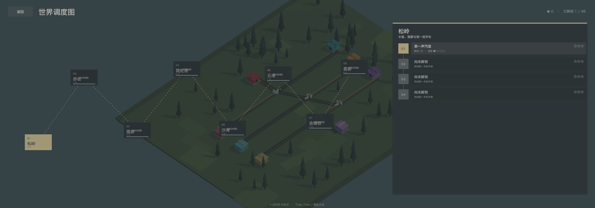
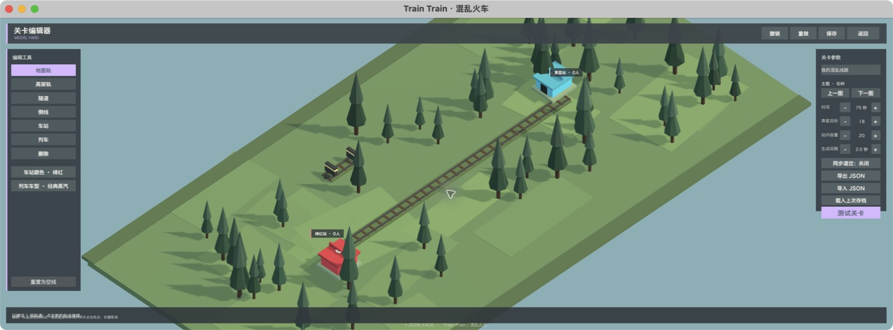

# Train Train / 混乱火车

一款低多边形俯视铁路动作解谜游戏。点击列车发车或停车，切换道岔、错开交叉车流，在倒计时结束前把不断出现的彩色乘客送到对应车站。

**Train Train / 混乱火车**  
© 2026 X4CE · MIT License




## 游戏特色

- 8 个主题区域，48 套独立线路布局
- 点击列车停车 / 恢复行驶，点击白色箭头道岔即时改线
- 四色乘客运输、连续到站计数、碰撞爆炸与限时评分
- 错色车站不会让乘客下车，列车继续沿环线寻找正确车站
- 列车自动停站，先卸下同色乘客，再装入站台上数量最多的一种乘客
- 加入侧线待避、无信号平交轨和双向交汇咽喉
- 关卡、无尽与关卡编辑器三种模式
- 4 种可选列车，具有不同载客容量和速度
- 八种低多边形场景主题：松岭、赤岩、霜原、霓虹港、沙海、云港、金穗谷、雾都
- 内置关卡编辑器：像铺设道路一样从起点拖到终点铺轨，支持桥隧、车站、列车、道岔同步、校验、保存与 JSON 导入导出
- 全部模型与界面在运行时生成，无外部付费素材依赖
- 本地进度、关卡解锁、星级和最高分存档
- 鼠标、触控与键盘操作，中英文动态字体回退
- Windows 64 位与 macOS Intel / Apple Silicon 通用构建

## 运行

1. 使用 Unity Hub 打开此目录。
2. 推荐 Unity `2022.3.62f3c1`，其他 `2022.3 LTS` 版本也可尝试。
3. 打开 `Assets/Scenes/Main.unity`。
4. 点击 Play。

项目启动时会自动创建游戏场景对象，因此即使当前打开的是空场景也能进入游戏。编辑器导入时会自动补充产品名、公司名和 Build Settings。

## 操作

- 点击列车：停车；再次点击：恢复行驶
- 鼠标左键 / 触屏：点击信号台切换道岔
- `Q` / `E`：用键盘依次选中道岔并切换线路
- `1` / `2` / `3` / `4`：停车或恢复对应颜色的列车
- 鼠标滚轮：缩放镜头
- `Esc` 或 `P`：暂停 / 继续
- `R`：重开当前关卡
- `M`：静音 / 恢复声音
- 编辑器内 `Ctrl/Cmd+Z`、`Ctrl/Cmd+Shift+Z` / `Ctrl/Cmd+Y`：撤销 / 重做
- 编辑器内 `Ctrl/Cmd+S`：保存，`F5`：试玩

关卡开始时列车会自动出发。点击车身停车、再次点击恢复，在岔口前切换线路并在交叉轨撞车前调度。列车经过车站会自动停靠：同色乘客下车，随后车厢会装载站台上数量最多的一种颜色。错色车站不会下客。累计送达本关要求的全部乘客后过关，列车相撞或倒计时结束则失败。完成越快，星级越高。

关卡编辑器铺轨有两种同样可用的手势：按住左键从起点拖到终点后松开，或点击起点、移动鼠标查看预览、再点击终点。每次操作只提交一条正交路径，不会无限接龙；`Esc`/右键或切换工具可取消当前起点，滚轮缩放编辑区。

“高架轨”至少铺设三格，首尾会分别自动生成上坡和下坡；普通地面轨不能直接接到高架节点。高架与地面在平面图上交叉时属于不同高度层，不会生成道岔，也不会互相撞车。隧道保持在地面层，并显示独立的洞口结构。

“列车”工具不再要求点两个格点：直接单击任意一段轨道中段，就会按该段方向放置一列列车。已放置列车会立即显示在轨道上，左侧工具按钮与状态栏会同步显示当前 `列车数 / 4`；撤销、重做和载入存档也会同步刷新车辆外观。

主菜单的“开始调度”会进入模式选择。“列车车库”中可以按累计星星解锁经典蒸汽、流线快车、城市地铁和重载货运四种车型。

## 构建版本

- Windows：[TrainTrain.exe](Builds/Windows/TrainTrain.exe) · [发布压缩包](Builds/TrainTrain-Windows-x64.zip)
- macOS：[TrainTrain.app](Builds/macOS/TrainTrain.app) · [发布压缩包](Builds/TrainTrain-macOS-universal.zip)

Unity 菜单 `Train Train / Build All Platforms` 可以重新生成两个平台。Windows 包需要 Unity 的 `Windows Build Support (Mono)` 模块；macOS 最终包为 `x86_64 + arm64` 通用二进制。

## 开源

本项目采用 MIT License。你可以自由学习、修改、分发和商用，保留版权与许可声明即可。

所有运行时美术、音效和 UI 均由项目代码生成，没有引入第三方美术包。`Train Train / 混乱火车` 与 `© 2026 X4CE` 应保留在游戏的标题、版权信息及衍生版本说明中。

## 项目结构

```text
Assets/
  Scenes/Main.unity
  Scripts/
    Core/       应用入口与总流程
    Data/       8 张地图与 48 关数据
    Gameplay/   列车、道岔和调度逻辑
    UI/         运行时界面与中文字体
    Visual/     低多边形模型、场景与材质
  Editor/       项目导入配置与验证工具
```

## 开发与验证

Unity 菜单中提供 `Train Train / Repair Project Setup`、`Train Train / Validate Project` 与 `Train Train / Build All Platforms`。验证会检查 48 关的唯一布局、8 张基础地图、逐图关卡数量、四种颜色的车站、侧线、关内连通性、编辑器起始关卡和 JSON 往返。

最近一次完整验证结果及平台测试边界见 [docs/VALIDATION.md](docs/VALIDATION.md)。

构建应用也支持不进入正式菜单的本地回归参数：

```bash
Train\ Train --dev --level=0 --autoplay \
  --capture=/tmp/train-train.png --quit-after=8
```

这些参数只用于截图与自动运行测试，不会写入关卡进度；普通玩家启动时不需要它们。
